<p align="center">
  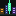
</p>

<h1 align="center">EdgeCraft-StrikeCity</h1>

<p align="center">
  <b>Trading agents and Strike's copy traders, living in one city.</b><br>
  Built on Strike Finance for the Strike Hackathon, October 2026.
</p>

<p align="center">
  <a href="https://edgecraft-strikecity.pages.dev">Live app (mainnet)</a> ·
  <a href="https://edgecraft-strikecity.pages.dev/#/city">Enter the city</a> ·
  <a href="https://qa.edgecraft-strikecity.pages.dev">Staging (testnet)</a> ·
  <a href="docs/EdgeCraft-StrikeCity.pdf">Project book (PDF)</a>
</p>

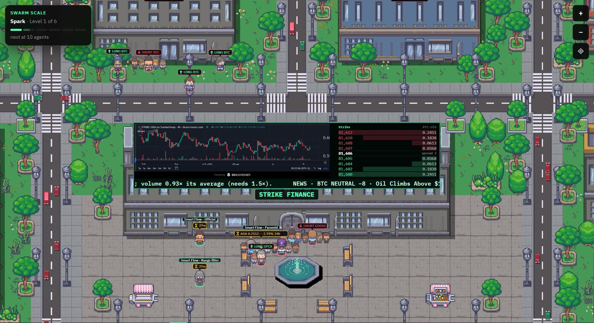

## The idea

Trading on Strike happens behind numbers. A trading bot is a process nobody sees, and a copy-trading leaderboard is a
list that tells you very little about what copying someone actually did for the people who tried it.

We wanted to make all of that visible. EdgeCraft-StrikeCity is a pixel-art city where every character is driven by
real data from Strike. Trading agents walk to the Signal Lab when a candle closes, to the Strike Finance building when they
send an order, and to a market's tower while they hold a position there. The traders people copy on Strike walk the
streets with their current copiers in a line behind them. Nothing moves for decoration.

Behind the city sits a complete product. You can create an agent that trades your own Strike account with a single
wallet signature, choose whom to copy with a score that was tested on real copies, and let your agent run that copy
for you under rules you sign.

| Live | 1 | 46 | 389 | 195 | 0.20 % |
|:---:|:---:|:---:|:---:|:---:|:---:|
| on Strike mainnet, with a staging copy on testnet | signature to start an agent on your own Strike account | Strike endpoints in use | real copies behind the score, re-tested hourly | automated tests, plus real-browser checks | builder fee per execution of the marketplace strategies only, approved by each user |

## What you can do

### Watch the agents and the traders, live
Every agent and every copied trader is a character. Click one to see what it holds, what it decided at the last candle
and why. Each market tower carries TradingView's live chart of its market and Strike's price on its sign; the Strike
Finance building shows STRIKE, Strike Finance's own token, next to Strike's live order book; the fountain changes colour
with BTC funding; and every car on the streets is a real trade on Strike mainnet: rest the mouse on one and press it to
see the trade. → [docs/CITY.md](docs/CITY.md)

<p align="center">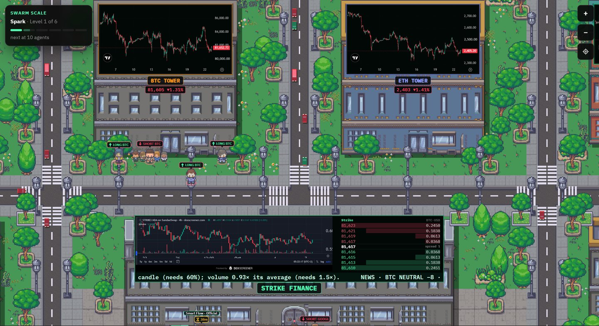</p>

### Step inside Strike Finance
The building at the centre of the city opens its doors: inside, Strike's own numbers, live from its public statistics.
Each day's trading volume as bars on the wall, the open interest and how many positions are long or short, every user
and every trade, the treasury and the vaults, and Strike's funding rate next to Binance's, Bybit's and OKX's. Your
agent walks in with you.

<p align="center">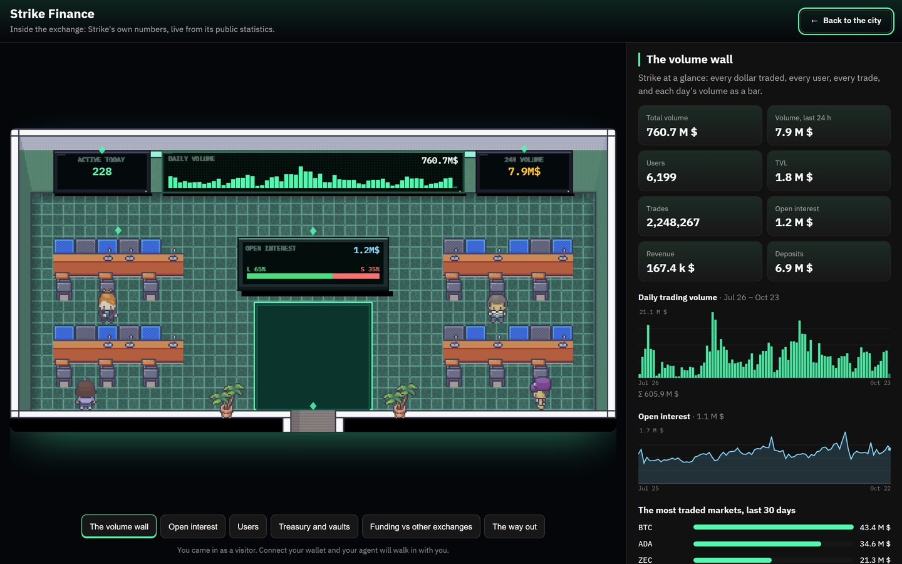</p>

### Pick a strategy from the marketplace
The landing page is a catalogue of strategies, each with its rules, its full backtest after every cost, and a page of
its own. One registry (`config/strategies.json`) feeds the catalogue, the onboarding, the agents' host and the server,
so a new strategy is added as data and appears everywhere at once.

<p align="center">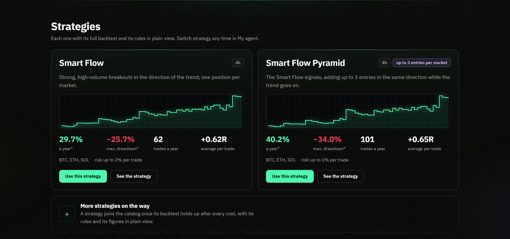</p>

### Create your agent with one signature
Design a character, give it a personality and a trade, pick a strategy, markets and risk, and sign once with your
Cardano wallet. That single signature goes to Strike's builder connect, which authorises an API wallet for the agent on
**your own Strike account** under our builder code. Your funds never leave Strike. The review screen spells out exactly
what the agent can and cannot do before you sign.

<p align="center">
  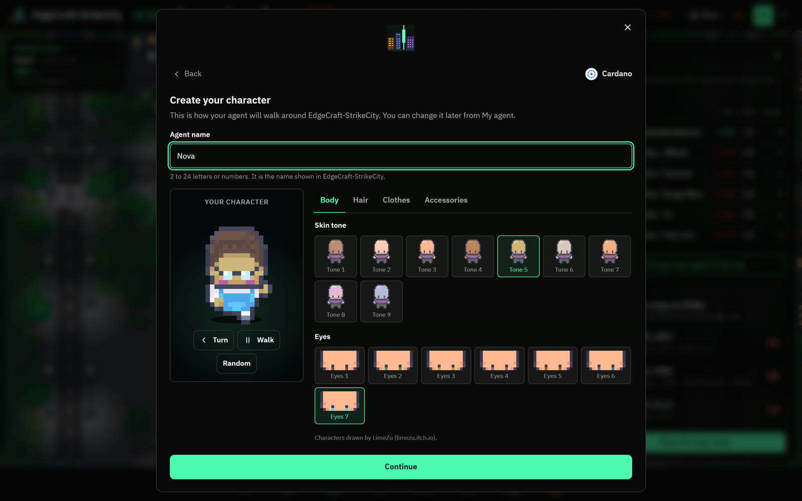
  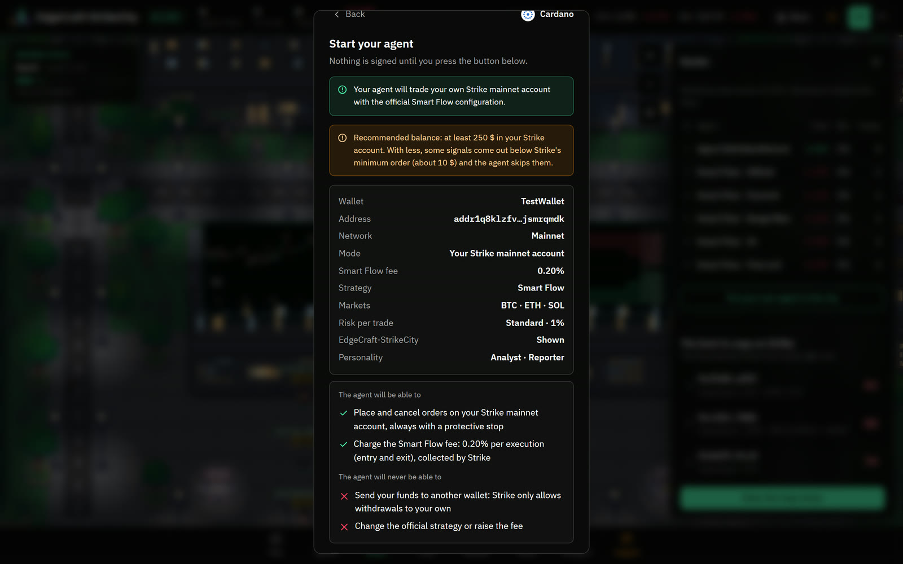
</p>
<p align="center">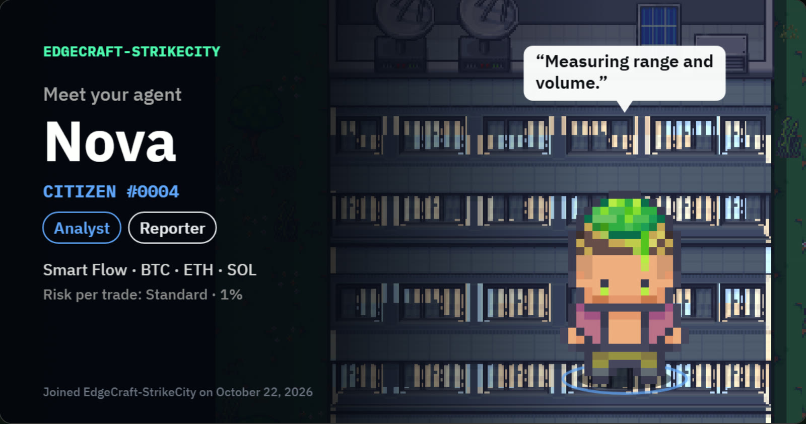</p>

### Choose whom to copy, with evidence
The **Copy Arena** reads Strike's copy trading and ranks every trader with the **Strike City score**, built from what
earlier copies of that trader really made, Strike's own copy score, the length of the record and the account's size.
The score is re-tested every hour against every copy Strike has published, and the result is shown in the arena.

<p align="center">
  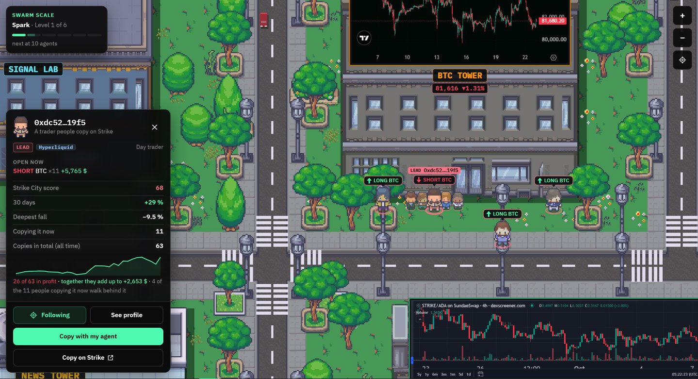
  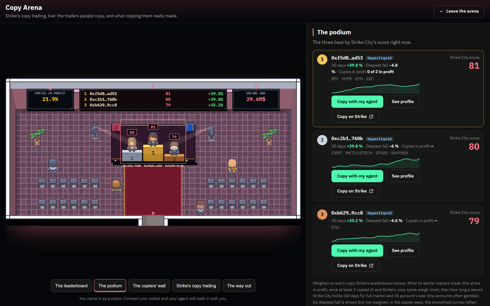
</p>

### Let your agent copy for you
Sign a copy plan: one trader, or "my agent chooses" with your own rules (minimum score, platforms, how often to review,
how many changes a week), plus the amount, stop-loss, leverage, markets to avoid and an end date. Your agent runs it on
**Strike's own copy trading**, in a sub-account of yours: one you already have that copies nobody (or the one you
choose), and only when there is none, a new one that Strike creates and funds from your main account. Strike itself
enforces the stop-loss. The copy and the strategy are independent: pause one and the other goes on. Copies pay no fee to
us.

<p align="center">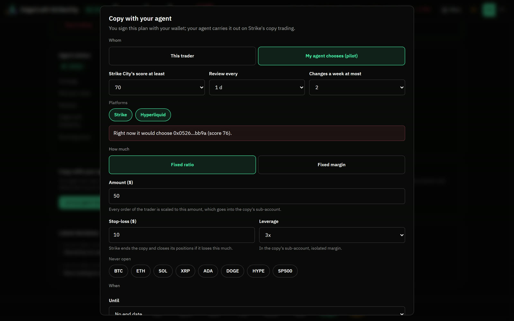</p>

### Read the news that moves your markets
The **News Tower** has six floors of headlines from official and tier-one sources, scored by a model, counted once per
story and checked against Strike's mark price after they came out. When a market's reading changes level, the agents
trading it walk over to read it. The strategies never trade on news; the news protects copies instead: a copy pauses
while the tower's security alarm is on (a major hack, an exchange going down) and, if its owner chose, around the big US
releases (Fed, CPI, jobs, PCE, GDP).

<p align="center">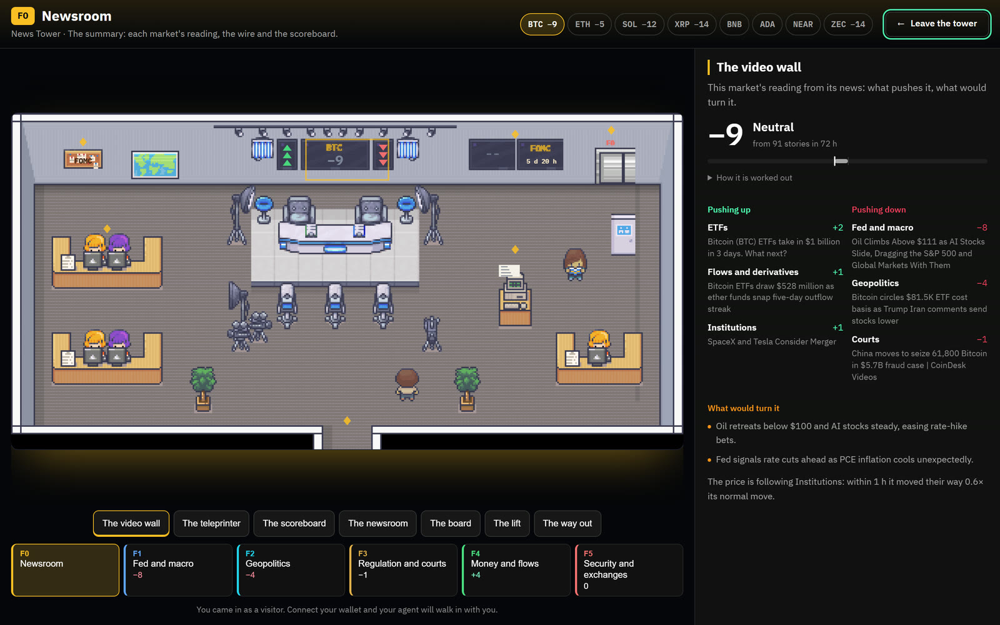</p>

### Get the alerts that matter
[@EdgeCraftStrikeCityBot](https://t.me/EdgeCraftStrikeCityBot) on Telegram watches Strike every minute. For everyone:
a market moving hard, extreme funding, a large position close to liquidation, whales, crowded markets, new or halted
markets, the security alarm, the big US releases, the Copy Arena's top traders; in the city each fresh one glows over its
building (Liquidation Alley, the Funding Cafe, a market's tower...). Link your agent from the **Alerts** tab and it also
looks after your own: every position's distance to liquidation in your account and sub-accounts, a trade your copy didn't
take, a position the trader already left, the trader in trouble on Strike or Hyperliquid, your agent's trades and
problems. Or `/watch` any Strike account, no wallet needed. → [docs/ALERTS.md](docs/ALERTS.md)

## Built on Strike

Strike is the venue for everything here, not just a data source: **46 Strike endpoints in six areas**, on mainnet
and testnet. Each call, and why we make it, is in [docs/STRIKE_INTEGRATION.md](docs/STRIKE_INTEGRATION.md).

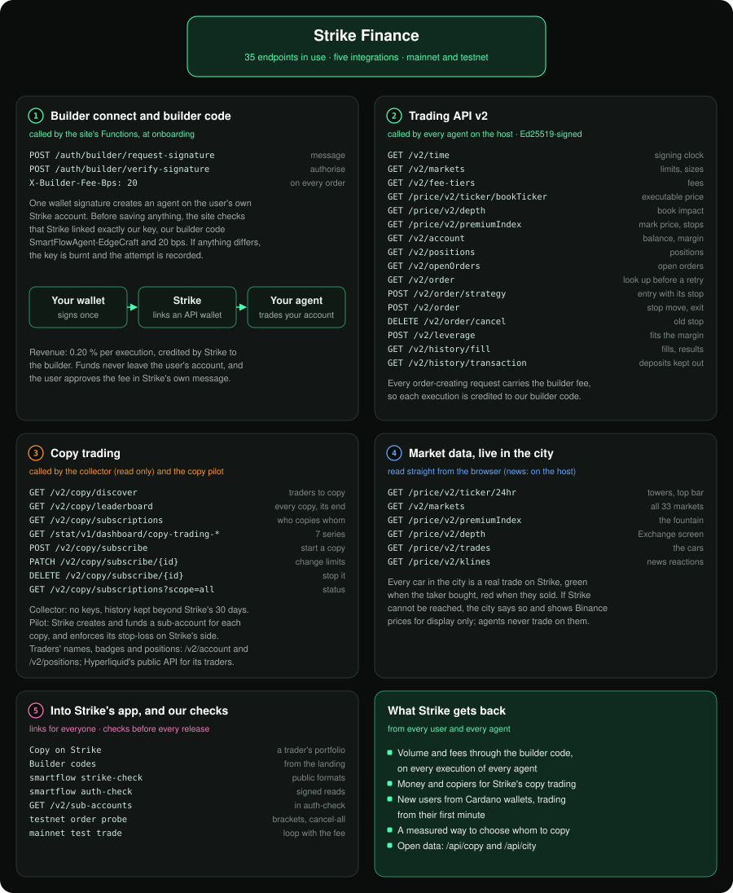

- **Builder connect and builder code** (2 endpoints and the fee header). Onboarding runs through `request-signature`
  and `verify-signature`, and the site checks that Strike linked exactly our key, our builder code
  (`SmartFlowAgent-EdgeCraft`) and our 0.20 % fee before saving anything. Every order of the marketplace strategy then
  carries the fee, so each of its executions is credited to the builder. Copies pay no fee to us.
- **Trading API v2** (16). Server time, markets, fee tiers, book ticker, depth, mark price, account, positions, open
  orders, order look-ups for safe retries, entries with their stop attached, stop moves and exits, cancels, leverage,
  fills and transfers, all signed with Ed25519 API-wallet keys.
- **Copy trading** (13). Discover, the leaderboard of every copy relationship and how it ended, who copies whom,
  Strike's copy-trading dashboard (its summary and six daily series), and managed copies with sub-accounts that Strike
  creates and funds (start, change, stop), with the stop-loss enforced by Strike.
- **Market data, live in the city** (6). 24-hour tickers on the towers, every market Strike lists in Markets, funding
  on the fountain, the order book on Strike Finance's screen, Strike's live trades as the cars, and Strike's 1-minute
  mark candles behind every news reaction.
- **Strike's own statistics** (11). Inside the Strike Finance building: the platform's totals, each day's volume, open
  interest, trades, users, revenue and liquidations, the treasury, every open position, Strike's funding against other
  exchanges, and its vaults, all from Strike's public statistics API.
- **Strike's app and our checks.** Every trader card links to that trader's public portfolio on Strike, where anyone
  can copy them by hand, and release checks prove before each release that Strike answers as the client expects.

## What we built during the hackathon

The project existed before the hackathon: the Smart Flow engine and its agents, builder-connect onboarding, the first
version of the city and the strategy marketplace. Between 21 and 23 October, in more than 40 commits and more than
12,000 new lines of code, we added:

| | |
|---|---|
| **Copy Arena** | A collector for the whole of Strike's copy trading (13 new endpoints) with history kept beyond Strike's 30 days, every trader linked by account with Strike's names and badges, traders walking the city with the people copying them, and the arena building with its leaderboard, podium and copiers' wall |
| **Strike City score** | A study of every copy Strike has published, a score built from what actually predicted a good copy, and an hourly public re-test shown inside the arena |
| **Copy with your agent** | Signed copy plans (one trader, or the agent choosing by your rules) carried out on Strike's own copy trading, in the owner's sub-accounts (a free one reused, a new one only when none is free), with Strike enforcing the stop-loss; proven on testnet, then opened on mainnet |
| **News Tower** | Tiered sources, model scoring, one vote per story, reactions measured on Strike's mark price, a reading per market, and a six-floor building your agent walks through |
| **Strike Finance, inside** | The exchange's building renamed and opened: Strike's own numbers live (daily volume as bars, open interest, longs and shorts, users, trades, TVL, revenue, funding against other exchanges, vaults) from Strike's statistics API (11 new endpoints), and STRIKE, Strike Finance's token, on its screen |
| **A living city** | The map redrawn with licensed LimeZu art, a character creator, personalities and trades for every agent, TradingView's live chart on every market tower, every car a real Strike trade, all 33 of Strike's markets, every copyable trader, a Results hub (strategies, copy pilot, Strike's copy trading, ranking), production showing real accounts only, and Connect wallet right in the dock |
| **Alerts** | A Telegram bot and an Alerts tab: Strike Finance's moments for everyone (moves, funding, the liquidation radar from Strike's live positions, whales, crowds, listings, security, US macro, the Copy Arena), shown over their buildings in the city; and, linked with a one-time code, each owner's agent, accounts, sub-accounts and copies (liquidation risk, trades a copy missed, positions the trader left, the trader in trouble) |
| **Your money, clearly** | An account chart with a tab per account (result, all accounts, main account, each copy sub-account), so money moved into a copy never counts as a loss in the result; sub-accounts reused instead of piling up; strategy and copy independent; questions answered by topic |
| **Security review** | Authentication, builder connect, copy plans end to end, host endpoints, headers, dependencies and secrets, reviewed before mainnet: no critical or high findings |
| **Verification** | Staging on Strike testnet first for every change, and real-browser checks with accessibility audits on every surface, in two languages, at desktop and phone sizes |
| **Documentation** | These docs, diagrams generated from code, and the project book (PDF) |

Each area, in detail and with its evidence: [docs/HACKATHON.md](docs/HACKATHON.md)

## Try it in five minutes

1. **No wallet needed.** Open [the city](https://edgecraft-strikecity.pages.dev/#/city), click a character with a
   pink ring to see a trader people copy on Strike, then open **Results**, its **Ranking** tab, and enter the **Copy Arena**.
2. Click the **Strike Finance** building and go inside for Strike's own numbers; then the **News Tower**, or open
   **News** in the top bar.
3. Browse the [strategy catalogue](https://edgecraft-strikecity.pages.dev/#strategies) and open a strategy's page.
4. **With a Cardano wallet** (Lace, Eternl, Yoroi, Typhon, VESPR, NuFi, Begin, GeroWallet or any CIP-30 wallet),
   press **Connect wallet** to create an agent on your own Strike account. On staging the same flow runs on Strike
   testnet with a Preprod wallet.

## Under the hood

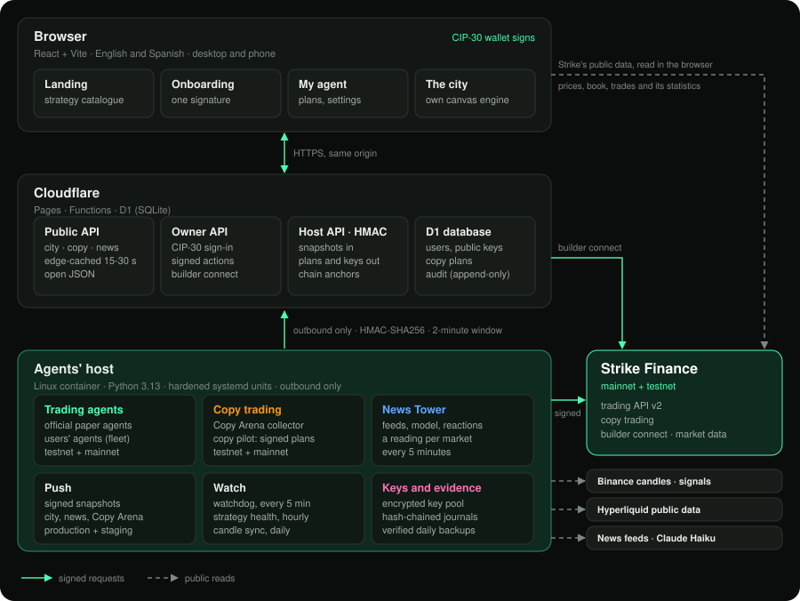

- **One engine for backtest and live**, fed candle by candle, so the live signal is the backtested signal.
- **Keys stay on the host.** The site only knows public keys; the host never listens to the internet.
- **Everything is evidence.** Every signed action, Strike request, fill and balance change is written to hash-chained
  logs whose heads are anchored on the site.
- **Quality.** 195 Python tests, plus real-browser checks with Playwright and axe-core on every surface of the city, in
  English and Spanish, on desktop and phone sizes.

More in [docs/ARCHITECTURE.md](docs/ARCHITECTURE.md), [docs/SECURITY.md](docs/SECURITY.md) and
[docs/QUALITY.md](docs/QUALITY.md).

## Where it goes next

Strike's 2026 roadmap brings vaults, a marketplace for trading tools, spot and real-world assets, a mobile app and
lending. This project already has the pieces for each: agent vaults with a verifiable record, a creators' marketplace
on top of the strategy registry, new districts of the city for new markets, and a social layer (seasons, leagues,
teams) around everything that trades on Strike. The plan, and how each part scales from tens to thousands of users, is
in [docs/ROADMAP.md](docs/ROADMAP.md).

## Documentation

| | |
|---|---|
| [Project book (PDF)](docs/EdgeCraft-StrikeCity.pdf) | Everything below in one designed document |
| [HACKATHON.md](docs/HACKATHON.md) | What was built during the hackathon, the judging criteria, a guide for judges |
| [STRIKE_INTEGRATION.md](docs/STRIKE_INTEGRATION.md) | Every Strike endpoint we call, and why |
| [CITY.md](docs/CITY.md) | The city: buildings, characters, live data, accessibility |
| [ALERTS.md](docs/ALERTS.md) | The alerts: Strike Finance for everyone, your agent and copies for you, the bot |
| [ARCHITECTURE.md](docs/ARCHITECTURE.md) | Components, services, data flows, design decisions |
| [STRATEGY.md](docs/STRATEGY.md) | Smart Flow, the research, risk levels, the builder fee, the Strike City score |
| [SECURITY.md](docs/SECURITY.md) | How users are protected, and the security review |
| [QUALITY.md](docs/QUALITY.md) | Staging on Strike testnet, the tests, real-browser checks, accessibility |
| [ROADMAP.md](docs/ROADMAP.md) | The future: product, scaling, business model |

## Run it locally

```bash
# Python: agents, research and host services
uv venv .venv && uv pip install -e ".[dev]"
.venv/Scripts/python -m pytest
.venv/Scripts/smartflow analyze --tf 240        # what the strategy sees right now (no orders)

# Web: from web/
npm install
npm run build && npm run preview                # http://localhost:4173, the city at /#/city
```

## Repository

```
src/smartflow/   the engine, agents, Strike client, copy trading, news, host services
web/             the site, the city and the Cloudflare Functions
config/          strategy registry, paper agents, city, news sources, macro calendar
deploy/          systemd units and install scripts for the agents' host
tests/           pytest suite        reports/  research outputs        verify_pyne/  engine cross-check
```

## Credits

City and character art by **LimeZu** (Modern Exteriors and Modern Interiors, limezu.itch.io), used under its commercial
licence; only composed images are published. Market and copy-trading data from Strike Finance, copied traders'
positions from Hyperliquid's public API, signal candles from Binance's public market data.

© 2026 EdgeCraft. All rights reserved. See [LICENSE](LICENSE).
