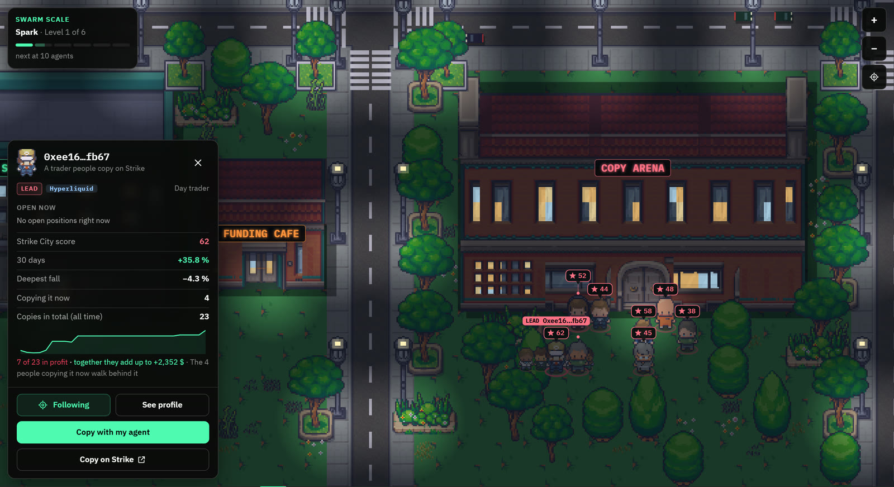
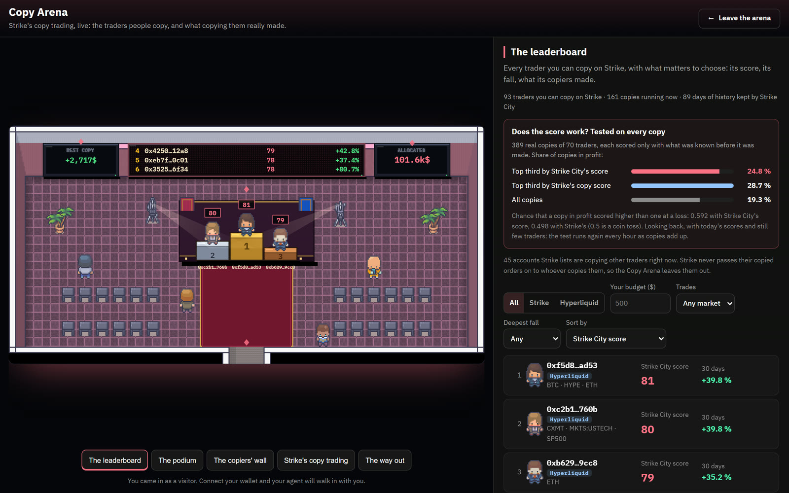
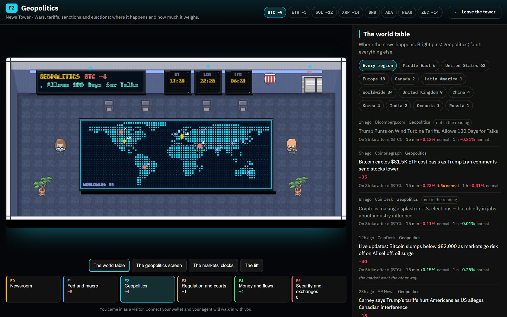

# EdgeCraft-StrikeCity

The city is the product's interface: a place where you can see, at a glance, what every agent is doing on Strike, who
is being copied and how it is going, and what the news says, all from live data. Its one rule: **nothing moves for
show.** A character walks because something real happened.

Open it at https://edgecraft-strikecity.pages.dev/#/city.

## Who walks the streets

| Character | Source | Where it goes and why |
|---|---|---|
| Official Smart Flow agents | the paper agents on the host, trading on Strike's real order book (on staging only: production shows real accounts only) | see the buildings below |
| Users' agents | each user's agent on their own Strike account | the same rules; the public sees shares, the owner sees amounts |
| Strike's copy traders ("leads", pink ring and ★ score) | Strike's copy trading (and Hyperliquid traders copied through Strike) | to the tower of the market of their biggest open position; to the Exchange for 75 s when they open, close, flip or resize on Strike; to the Copy Arena's door while they hold nothing |
| The people copying a lead right now | Strike's copy leaderboard | walk behind their lead, in a line |
| An agent copying a lead for its owner | the owner's signed copy plan, as the host reports it | stands with that lead |

## What each building means

| Building | An agent goes there when |
|---|---|
| Signal Lab | a candle closes and it analyses its markets |
| BTC / ETH / SOL towers, Alt Row | it holds a position in that market |
| Strike Finance | it sends an order or a signal fires |
| Risk Office | the risk engine checks or refuses a signal |
| Liquidation Alley | a trade closed at its stop |
| Funding Cafe | a trade closed by its exit rule |
| News Tower | the news reading of a market it trades changes level (very bullish … very bearish); it reads it, and its strategy never trades on it (the tower's security alarm and calendar pause copies instead) |
| Copy Arena | the leads with nothing open wait at its door, with the agents copying them |
| Agent Homes | it is paused, stopped, or waiting for a first deposit |
| Plaza | it is waiting for its next setup (with short "shifts" at its trade's building) |

Each agent also has a **personality** (its voice in its card) and a **trade** (chartist, reporter, tape reader, risk
keeper): during its shifts its bubble shows the real data its trade reads there (last candle's range and volume, the
news reading, the day's move, its day in R). The personality never changes how it trades.

## Live data drawn on the map

- **Market towers**: Strike's price and 24h change on each tower's sign.
- **Strike Finance**: its screen shows STRIKE, Strike Finance's own token on Cardano (DEX Screener's chart of the
  STRIKE/ADA pool on SundaeSwap; TradingView has none), next to Strike's live BTC order book.
- **Market towers' screens**: TradingView's live chart of the tower's market, on a screen across the top of each tower
  (its sign moves under it). Each one loads only once its tower comes into view. At night every screen lights itself:
  no window glow or darkness is ever drawn over it.

- **The fountain**: its colour follows BTC funding on Strike (who pays whom).
- **News Tower facade**: an LED marquee with the latest catalysts.
- **Cars**: every car on the streets is a real trade on Strike mainnet (`/price/v2/trades`, BTC and the busiest markets
  in turn). Green when the taker bought, red when they sold, a truck from 5,000 $. A car stops under the mouse, or
  under a finger, with a light outline; pressing it shows the trade (market, side, size, price, value and how long
  ago). With reduced motion the cars park along their road instead of driving.
- **Weather**: calm, breezy or stormy with BTC's 24h move.
- **Top bar**: the live badge, BTC, ETH and SOL with their 24-hour change, the news (with the next US macro release),
  the weather and the language, nothing more: the map keeps the room.
- **The city's figures** (Results, summary tab): agents online, agents in a trade, the trades and result over the last 24
  hours, and the totals. On production they count real accounts only (the paper agents that test the strategies live
  on staging); on staging they count every agent, paper and testnet, because that is what staging is for.
- **Logos, as Strike shows them**: each agent's row carries the official logos of the markets it analyses, and each
  trader's row those of what it holds (two logos, then "+n" for the rest; every name in its tooltip and for screen
  readers). Strike's own image for each of its 33 markets, Hyperliquid's for an asset Strike does not list, as Strike's
  app does. The wallet list shows every Cardano wallet's official icon, installed or not.

## Going inside

- **News Tower** (six floors: Newsroom, Fed and macro, Geopolitics, Regulation and courts, Money and flows, Security and
  exchanges). Your agent runs to the door, goes in, takes the lift to whatever you choose and reads it with you. Every
  screen inside is live: each market's reading and what pushes it up or down, the wire, the scoreboard of past readings,
  a world table with pins by region, the calendar.
- **Strike Finance**: Strike's own numbers, live from its public statistics. The volume wall (each day's volume as
  bars), users and the treasury on the side screens, the open interest and how many positions are long or short on the
  console, Strike's funding against Binance, Bybit and OKX at the desks, and Strike's vaults. Open it from the building's
  card, or at `#/city?strike`.

- **Copy Arena**: the leaderboard on an LED wall, the three best on a podium, the copiers' wall (the copies that went
  best) and Strike's copy-trading totals. From any trader: their profile, "Copy on Strike", and "Copy with my agent".

Without an agent of your own you go in as a visitor.

  
  

## The dock

Map · Agents (every agent with the logos of its markets, and every trader people can copy on Strike with the logos of
what it holds: the ones walking the city first) · Results (tabs: a summary with the city's figures, the marketplace strategies with their live results next to each backtest, the copy pilot, Strike's copy
trading, and the ranking with the best traders to copy) · Feed (what just happened) · Markets (every market
Strike lists: the agents' markets first, then stocks, indices, commodities and more crypto, with price, 24-hour change,
funding, volume and maximum leverage) · Alerts (the Telegram bot, linking your agent to it, and Strike's latest alerts,
each a press away from its building) · Guide (what everything means, a legend, the roadmap) · My agent · Suggest. On
phones the dock leaves Map out: each panel has its close button.
(feedback with an optional screenshot). Until a wallet is connected, My agent's place shows **Connect wallet**; it
turns back into My agent once one is in, and into Connect wallet again if it leaves.

## Accessibility and quality

- Every surface is checked against WCAG 2.2 AA with axe-core in a real browser, in English and Spanish, at desktop and
  phone widths (`web/scripts/verify_city_ui.py` walks every panel and button: 282 checks per language).
- The map has a text description, keyboard control (arrows, + and −, Escape) and a "follow" mode; dialogs trap focus
  and restore it; status updates are announced.
- Reduced motion is honoured: characters jump to where they are going and nothing pulses.
- When you are inside a building or in "My agent", the city stops drawing in your browser (the agents keep trading).
- Art: LimeZu's Modern Exteriors and Modern Interiors, composed by `web/scripts/build_city.py` and `build_tower.py`
  into the images the site serves.
