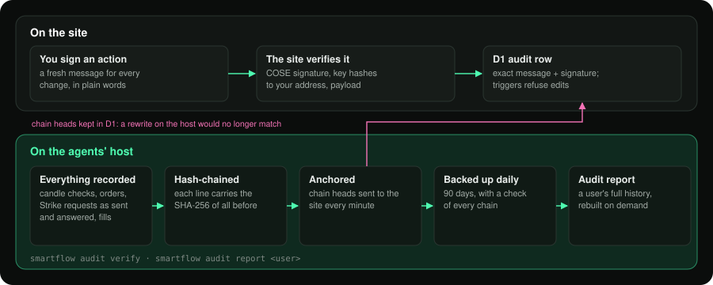

# Security

EdgeCraft-StrikeCity moves real money on behalf of its users: agents trade their Strike accounts and copy plans start
real copies. This page explains what protects them, and what a security review of the code found.

## What we hold, and what we never hold

| | Where |
|---|---|
| Users' funds | Never with us: always in the user's own Strike account. Withdrawals can only go to the user's own wallet (Strike locks the recipient server-side), and our agents never request one. |
| API-wallet private keys | Generated on the agents' host, encrypted at rest (AES-256-GCM, master key readable only by the service user), never sent anywhere. |
| API-wallet public keys, account ids | On the site (D1), to tell the host which key serves which user. |
| Wallet signatures and the exact messages signed | On the site, in an append-only audit table, as proof of consent. |

## Authentication and consent

- **Sign-in** is a CIP-30 `signData` over a one-time message (nonce, expiry, site). The server verifies the COSE
  signature itself: EdDSA, the signed address is the user's address, the payload is our exact message, and the public
  key **hashes to the address's payment or stake key**. It returns a bearer session (HMAC, 7 days); there are no
  cookies, so there is no cross-site request forgery surface.
- **Every change is a fresh signature**: pause, resume, settings, character, test trade, delete, and the copy plan.
  Each challenge is single-use, expires in 5 minutes, and is rate-limited per IP and per address. The message spells
  out in plain words what is being approved (for a copy plan: whom, how much, stop-loss, leverage, excluded markets,
  end date).
- **Builder connect**: the site checks that Strike authorised exactly our API-wallet key, builder code and fee before
  anything is saved; otherwise the key is burnt and the attempt recorded.

## The agents' host

- **Outbound only**: no inbound ports and no tunnel. The host polls the site and pushes signed snapshots.
- **Host ↔ site**: HMAC-SHA256 over `"{timestamp}.{payload}"` with a 2-minute window, compared in constant time, on every
  internal endpoint.
- **Services** run as an unprivileged user with `NoNewPrivileges`, `ProtectSystem=strict`, `ProtectHome`, private tmp,
  read-only access to code and keys, and memory caps.
- **Real money needs explicit switches**: mainnet agents and the mainnet copy pilot refuse to start without
  `--allow-mainnet`, and autonomous trading needs an acknowledgement in the service's own settings file.

## Limits that protect users

- Risk per trade from 0.5 % to 2 %, daily and weekly loss limits, a stop placed with every entry, and a strategy-wide
  safety hold when live results leave the backtest's range.
- Copies run in a **managed sub-account** that Strike creates and funds for that copy: the copy can never touch more than
  what was put into it, and **Strike** enforces the stop-loss. A copy Strike refused or stopped halts the plan until the
  owner signs again.
- A deleted agent has its Strike connection turned off and any copy it runs stopped.

## Evidence: tamper-evident records

- The site's `audit` table is append-only (database triggers refuse updates and deletes). It records every signed
  action with the exact message and signature, refusals included.
- On the host, every agent's journal, every Strike request that changes something (as sent and as answered), every fill
  and every balance change is written to **hash-chained** logs: each line carries the SHA-256 of everything before it.
- The heads of those chains are **anchored on the site** every minute. A rewrite on the host would no longer match.
- Daily backups, with a check of every chain. `smartflow audit report <user>` rebuilds a user's full history from these
  records.

## Web hardening

- Strict input validation on every endpoint (sizes, types, enumerations), parameterised SQL only, and generic error
  messages (no internals leak).
- No HTML injection sinks in the front end (React escaping only). Uploaded screenshots must be JPEG, PNG or WebP under
  1 MB, and are served with `nosniff` through signed links.
- Headers: HSTS, `X-Frame-Options: DENY`, `frame-ancestors 'none'`, `nosniff`, a strict referrer policy, and a
  permissions policy with no camera, microphone, geolocation or payment.
- No secrets in the repository (its full history scanned for common key and token formats); the operator's local secrets are
  encrypted at rest.

## Security review (22 October 2026)

Scope: authentication and signatures (`web/server/cardano.ts`, `util.ts`, `handlers.ts`), builder connect
(`live.ts`), copy plans end to end (`copyplan.ts`, `src/smartflow/copytrade/pilot.py`, the systemd units), host
endpoints, feedback uploads, security headers, dependencies, and secrets in git.

**Result: no critical or high findings.** The copy feature was opened in production after this review.

| Area | Finding | Status |
|---|---|---|
| CIP-30 verification | Key-to-address binding, payload and address checks present; cross-checked against Python references (BLAKE2b 33/33, CIP-30 10/10 valid and tampered cases) | OK |
| Replay | Single-use challenges with expiry; host requests time-boxed to 2 minutes | OK |
| Keys | Private keys only on the host, encrypted; the site stores public keys | OK |
| Copy pilot | Stop-loss on Strike's side, isolated sub-account, halt on refusal, idempotent requests | OK |
| Dependencies | `npm audit --omit=dev`: 0 vulnerabilities | OK |
| Secrets in git | None found in the tree or the history (common key and token formats) | OK |

**Hardening backlog** (none blocks use today):
1. The host trusts the plans the site serves. Next step: the host re-verifies each plan's wallet signature itself, so
   that a compromised site could not alter a plan.
2. Add a `script-src` Content Security Policy once the third-party chart widget is self-hosted.
3. The legacy read-only API on the host listens on the local network; bind it to localhost or retire it.
4. Sessions live in the browser's local storage; the absence of injection sinks keeps that safe, and a shorter session
   with refresh would reduce exposure further.
5. Run the host in two locations for availability.
