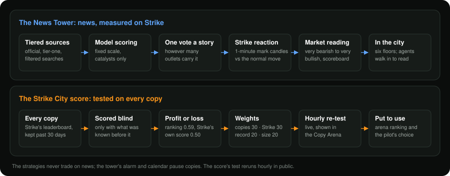

# Strategy and research

## Smart Flow

Smart Flow is the author's own trend-breakout strategy, from [EdgeCraft](https://edgecraft.pages.dev/#faq), the author's
studio of indicators for TradingView. Every agent in the city runs it, on Strike perpetuals and the 4-hour timeframe.

- **Entry**: a 4-hour candle with a range of at least 1 ATR and a body of at least 60 % that closes beyond the last 20
  candles, on 1.5× average volume, aligned with the daily market structure. Breakouts born inside a very wide range
  (the last 100 candles spanning more than 12 ATR) are skipped: those tend to fail.
- **Protection**: a stop 1.5 ATR away is placed on Strike together with the entry. The size is computed from that stop
  and the chosen risk, with room left for slippage.
- **Exit**: a 4 ATR chandelier stop that follows the price on the exchange, and a close back through the 10-candle
  channel.
- **Smart Flow** holds one position per market. **Smart Flow Pyramid** takes the same signals: the first opens an
  entry, and each new signal in the same direction while the trend goes on adds another, up to 3 per market (never all
  at once, and never twice on the same candle), each with its own stop and exit.

It is a trend strategy: about one trade in three wins, and the winners are several times larger than the losers. It is
judged over many trades, never over a handful.

## How it was researched

- **One engine** (`src/smartflow/core`) for backtest and live, fed bar by bar. It was checked against an independent
  re-translation of the original Pine script running in PyneCore (identical signals over 6,000 4-hour candles) and
  against TradingView exports; the live journals are replayed candle by candle against the backtest engine.
- **Realistic costs**: Strike taker fee 5 bp and the builder fee 20 bp per fill, slippage, funding, Strike's minimum
  order, margin and the agent's own loss limits.
- **Protocol**: development, validation and test periods, plus five assets the rules never saw. A variant is adopted
  only if it beats the reference in all three periods and is not worse out of sample. The criteria are written before
  the results are looked at.
- **Studies**: entries and filters, exits and stops (`reports/exit_study*.md`), the builder fee, and scheduled US macro
  releases (`reports/event_study.md`: no rule around Fed, CPI or payrolls improved anything, so the agents do not
  change around them).

## Backtest (2022-01-01 → 2026-10-18, BTC/ETH/SOL, 1 % risk per trade, all costs)

| | Smart Flow | Smart Flow Pyramid |
|---|---|---|
| Trades (per year) | 297 (62) | 482 (101) |
| Average result per trade | +0.62 R (95 % CI +0.22 to +1.07) | +0.65 R (95 % CI +0.31 to +1.00) |
| Win rate · average winner | 34.3 % · +3.88 R | 33.8 % · +4.03 R |
| Profit factor | 1.88 | 1.91 |
| Annual return · max drawdown (account, open trades included) | 29.7 % · 25.7 % | 40.2 % · 34.0 % |

Source: `config/figures/<strategy>.json`, generated by `smartflow figures --builder-bps 20` with the same account model
the agents use. These are simulated results: past performance, real or simulated, does not guarantee future results.

## Risk levels

| Preset | Risk per trade | Allowed with |
|---|---|---|
| Conservative | 0.5 % | both strategies |
| Standard (default) | 1 % | both strategies |
| Assertive | 2 % | Smart Flow only |

Daily and weekly loss limits (2 % and 5 %) stop new entries; open trades keep their stop. Leverage is the lowest whose
initial margin fits in 90 % of the available balance, up to 5×. Recommended balance: 250 $.

**Safety hold**: every hour each strategy's official paper agent is compared with its backtest. If its results fall
clearly outside what the backtest allows, users' agents on that strategy stop opening new trades until the operator
reviews it (`src/smartflow/live/health.py`).

## The builder fee

Smart Flow earns **0.20 % per execution** through Strike's builder code. The fee was chosen from the research, not the
other way round: at 20 bp the 4-hour edge stays statistically significant after every cost; much higher fees erase it
(a 1 % fee would make the user lose). Users approve the fee explicitly when they sign Strike's builder-connect message.

The fee applies **only to the trades of the marketplace strategies** (Smart Flow and Smart Flow Pyramid). A copy run
with "copy with your agent" pays no fee to us: Strike's own fees and copy-trading terms are the only costs.

## The Strike City score

The Copy Arena ranks Strike's copy traders with a 0-100 score built from parts anyone can read on the trader's profile:

| Part | Weight |
|---|---|
| Strike's own copy score | 30 % |
| Share of earlier copies that ended in profit (from 3 copies) | 30 % |
| Track record Strike City holds (60 days for full marks) | 20 % |
| Account size (tiny accounts often gamble) | 20 % |
| Deepest fall of the PnL | shown, not weighted |

A part that cannot be known yet is left out and the others share its weight.

**Tested on every copy.** The weights come from a study of the copies Strike's leaderboard publishes, each scored only
with what was known before it was made. In that study, what earlier copiers made predicted outcomes best, and Strike's
own score alone did not. A smooth PnL curve did not help either: market makers' smooth curves were the hardest to copy,
which is why the fall is shown but not weighted.

The collector repeats the test every hour on every copy it has seen, and the arena shows the result live. At the
time of writing, on 389 copies of 70 traders:
- **Ranking**: the chance that a copy in profit scored higher than one at a loss is 0.59 with the Strike City score and
  0.50 with Strike's (0.5 is a coin toss).
- **Top third**: the share of copies in profit among each score's top third is 24.8 % with ours and 28.7 % with Strike's,
  against 19.3 % for all copies.
- **Caveats**: few traders, today's scores looking back. The test reruns as copies add up.
