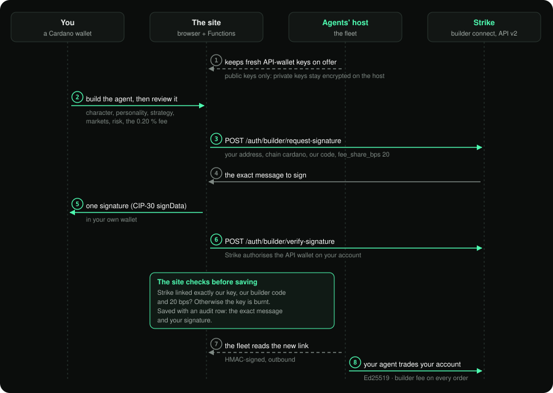
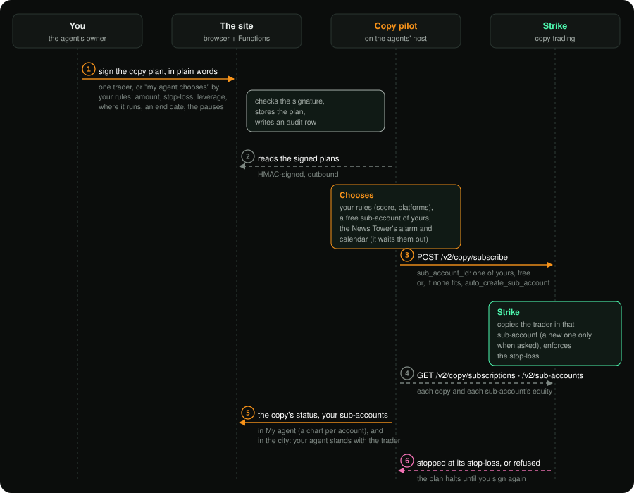
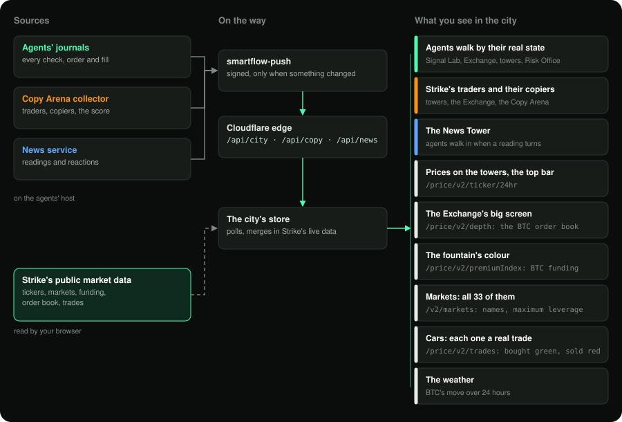

# How EdgeCraft-StrikeCity uses Strike

Strike is the venue for everything in this project. Users' agents trade on Strike, copies run on Strike's own copy
trading, we earn through Strike's builder code, and the city draws Strike's market as it moves. This page lists every
call we make to Strike and what it is for, so nothing is left to guesswork.

We use both networks: production talks to mainnet (`https://api.strikefinance.org`), and the staging site runs the same
code against testnet (`https://api-v2-testnet.strikefinance.org`).

## At a glance

| Area | Endpoints | Called by | What it gives users and Strike |
|---|:---:|---|---|
| [Builder connect and builder code](#1-onboarding-through-builder-connect) | 2 + the fee header | the site's Functions | An agent on your own Strike account with one signature; 0.20 % per execution to the builder |
| [Trading API v2](#2-trading-the-agents) | 16 | every agent, on the host | Entries with their stop attached, exits, leverage, results that leave deposits out |
| [Copy trading](#3-copy-trading) | 14 | the collector and the copy pilot, on the host | The Copy Arena, the Strike City score, and copies your agent runs in your sub-accounts (reused, not piled up) |
| [Market data](#4-strikes-market-in-the-city) | 3 more (6 in all) | the browser; the news service | Strike's market drawn live: prices, order book, funding, all its markets, every trade as a car |
| [Strike's own statistics](#5-strikes-own-numbers-inside-the-strike-finance-building) | 11 | the browser, inside the Strike Finance building | The platform's totals, daily volume, open interest, users, revenue, treasury, live positions, funding against other exchanges, vaults |
| [Checks](#7-checking-our-side-of-the-contract) | (counted above) | our release checks | Proof, before every release, that Strike answers as the client expects |
| **Total** | **46** | | Mainnet and testnet, same code |

## 1. Onboarding through builder connect

A user's agent trades the user's own Strike account through an API wallet that Strike authorises for our builder code.
The private key of that API wallet is generated on our host and never leaves it.

1. The site reserves a fresh public key from the host's pool.
2. It asks Strike for the message the user's wallet must sign:
   `POST /auth/builder/request-signature` with the address, `chain: cardano`, our code and `fee_share_bps`.
3. The user's Cardano wallet signs Strike's message (CIP-30 `signData`).
4. The site sends that signature to Strike: `POST /auth/builder/verify-signature`.
5. Before saving anything, the site checks that Strike linked **exactly** our key, our builder code
   (`SmartFlowAgent-EdgeCraft`) and our fee (20 bps). If anything differs, the key is burnt and the attempt recorded.

The same signature also proves the user owns the wallet, so creating an agent takes one signature in total.

## 2. Trading: the agents

Every user's agent and every official paper agent runs the same engine. Requests are signed with Ed25519 API-wallet
keys, and the client syncs with Strike's clock before trading.

| What for | Endpoints |
|---|---|
| Server time (requests are signed with it) | `GET /v2/time` |
| Markets, limits and fees | `GET /v2/markets`, `GET /v2/fee-tiers` |
| Executable prices and book impact | `GET /price/v2/ticker/bookTicker`, `GET /price/v2/depth` |
| Mark price (valuation and stops) | `GET /price/v2/premiumIndex` |
| Account, positions, open orders | `GET /v2/account`, `GET /v2/positions`, `GET /v2/openOrders` |
| Looking an order up before retrying it | `GET /v2/order` (by `client_order_id`) |
| Entries with the stop attached | `POST /v2/order/strategy` (a limit IOC entry with its `sl_order`) |
| Moving the stop and exiting | `DELETE /v2/order/cancel`, `POST /v2/order` (a reduce-only stop on the mark price, or a reduce-only market exit) |
| Leverage that fits Strike's margin | `POST /v2/leverage` |
| Results that leave deposits out | `GET /v2/history/fill`, `GET /v2/history/transaction` (deposits, withdrawals, transfers) |

Every order a marketplace strategy places carries `X-Builder-Fee-Bps: 20`, so each execution is attributed to our
builder code (copies run on Strike's copy trading and carry no builder fee). If an agent ever sees a fill attributed to
someone else, it raises an error alert to the operator.

**Test trade.** From "My agent" an owner can ask for a test: the agent opens Strike's minimum order with its stop, holds
it for two minutes and closes it, so a new user sees the whole loop work on their own account. Test trades are marked
and never counted in any statistic.

## 3. Copy trading

### The Copy Arena's collector (read only, no keys)

`smartflow copy` builds the arena's data and keeps history beyond the 30 days Strike's API returns.

| What for | Endpoints |
|---|---|
| Traders to copy, on Strike and on Hyperliquid through Strike | `GET /v2/copy/discover` |
| Every copy relationship and how it went (active, stopped, liquidated) | `GET /v2/copy/leaderboard` |
| A trader's account, Strike name, badges, sub-accounts and whom they copy | `GET /v2/account`, `GET /v2/copy/subscriptions` |
| The traders' open positions (they walk to that market's tower) | `GET /v2/positions` on Strike, `clearinghouseState` on Hyperliquid's public API |
| Strike's copy-trading totals | `GET /stat/v1/dashboard/copy-trading-summary` and the daily `-volumes`, `-subscriptions`, `-profits`, `-liquidations`, `-allocated`, `-open-interest` |

Traders are linked by their account: a sub-account opens its main account, Strike's own names and badges are shown, and
accounts that only copy others are left out (Strike never passes their copied orders on to whoever copies them). From
all this the collector computes the **Strike City score** and re-tests it every hour against every copy Strike has
published ([STRATEGY.md](STRATEGY.md#the-strike-city-score)).

### Copy with your agent (signed by the owner, run on Strike)

`smartflow copypilot` carries out each owner's signed copy plan with that owner's API wallet.

| What for | Endpoints |
|---|---|
| The owner's sub-accounts: name, equity, available money (and, with the copies, which one copies whom) | `GET /v2/sub-accounts` |
| Start a copy in a sub-account the owner already has: one that copies nobody (with the money it holds, up to the plan's amount), or the one they chose | `POST /v2/copy/subscribe` with `sub_account_id` |
| Only when none fits, start a managed copy: Strike creates a sub-account for it and funds it from the owner's main account | `POST /v2/copy/subscribe` (`auto_create_sub_account`, `source_account_id`, fixed ratio or fixed margin, `stop_loss_amount`, `excluded_symbols`, isolated `margin_settings`, an idempotent `request_id`) |
| Change a running copy's limits | `PATCH /v2/copy/subscribe/{subscription_id}` |
| Stop a copy | `DELETE /v2/copy/subscribe/{subscription_id}` |
| Where each copy really is, in Strike's own words | `GET /v2/copy/subscriptions?scope=all` |
| Balances before asking, so the owner is told plainly when the money is not there | `GET /v2/account` (main account and sub-accounts) |

Strike applies the stop-loss on its side. A copy that Strike stopped at its stop-loss, or refused, halts the plan until
the owner signs again. Nothing here moves money out of Strike.

A sub-account runs one copy at a time, and Strike allows 20 per account, so the pilot reuses them instead of creating one
per copy. Money moves between an owner's main account and sub-accounts only in Strike's app (Strike keeps those
transfers to it: they are not open to API wallets), so "My agent" shows each sub-account's balance and links there to
top one up. The pilot also reads each sub-account's equity every two hours, so the owner's chart can show every account
and never a transfer as a loss.

The News Tower protects copies: a copy pauses while its security alarm is on (a hack, or an exchange's halt or
insolvency, scored -30 or worse in the last day) and, if the owner chose, from 30 minutes before to an hour after the
big US releases on its calendar (Fed decisions, CPI, jobs, PCE, GDP). The strategies never trade on news.

## 4. Strike's market in the city

| What you see | Endpoint |
|---|---|
| Prices, 24-hour change and volume on the towers, the top bar and Markets | `GET /price/v2/ticker/24hr` |
| Every market Strike lists (33 today: crypto, stocks, indices, commodities), with its name and maximum leverage | `GET /v2/markets` |
| The fountain's colour (BTC funding) and mark prices | `GET /price/v2/premiumIndex` |
| The BTC order book on the Strike Finance building's screen | `GET /price/v2/depth` |
| The cars: every car in the city is a real trade on Strike mainnet (green when the taker bought, red when they sold, a truck from 5,000 $; press one to see it) | `GET /price/v2/trades`, BTC and the busiest markets in turn, every 15 s |
| How the price reacted after each headline | Strike's 1-minute mark-price candles, `GET /price/v2/klines` (on the host) |

The browser reads these public endpoints directly, so the city shows Strike's market as it is, with no copy of ours in
between. Two charts come from outside Strike's API, for people to look at: each market tower carries TradingView's live
chart of its market, and the Strike Finance building shows STRIKE, Strike Finance's own token on Cardano (the STRIKE/ADA
pool on SundaeSwap), through DEX Screener's chart, because TradingView has no chart of it. If Strike's public price endpoints cannot be reached, the city says so on screen and shows Binance prices
instead, for display only. The agents never trade on that fallback.

## 5. Strike's own numbers, inside the Strike Finance building

Go into the building at the centre of the city and Strike's own statistics are on its walls, read straight from the
browser while you are inside (and every minute after that). Nobody shows these numbers on Strike's own pages today.

| What you see inside | Endpoint (`/stat/v1` unless said) |
|---|---|
| The totals: volume, users, deposits, withdrawals, liquidated, revenue | `GET /dashboard/summary` |
| Each day's trading volume, as bars, and the most traded markets | `GET /dashboard/volumes` |
| Open interest, day by day | `GET /dashboard/open-interest` |
| Trades a day, and every trade ever | `GET /dashboard/trades` |
| Active and new users a day | `GET /dashboard/users` |
| Revenue a day | `GET /dashboard/revenue` |
| Liquidations | `GET /dashboard/liquidations` |
| The treasury (TVL), asset by asset | `GET /dashboard/treasury` |
| Every open position right now: the open interest by market, and how many positions are long or short (no account shown) | `GET /stats/live-positions` |
| Strike's funding rate next to Binance's, Bybit's and OKX's, market by market | `GET /stats/coin/funding-rate-comparison` |
| Strike's vaults: equity, share price, the leader's fee | `GET /v2/vaults` |

Every long on a perpetuals exchange has a short on the other side, so the open interest shown is one side's value, and
what tells the mood is how many positions are long. The summary's own open-interest field reads zero today, so the hall
computes it from the live positions and the daily series instead.

## 6. Links into Strike's app

Every trader card and profile has **Copy on Strike**, which opens that trader's public portfolio in Strike's app, where
anyone can copy them by hand. The landing page links to Strike's app and to its builder-codes page.

## 7. Checking our side of the contract

- `smartflow strike-check` confirms Strike's public API answers in the formats the client expects.
- `smartflow auth-check` runs signed reads end to end: account, positions, open orders, fills and `GET /v2/sub-accounts`.
- A testnet probe exercised the order mechanics (brackets, a duplicate `client_order_id`, cancel-all), and a mainnet
  probe ran the full test-trade loop with the builder fee on a real account.
- Every Strike request that changes something is written to the agent's hash-chained journal as it was sent and as
  Strike answered it.

## 8. Confirmed with Strike's team

Before going live we put our open questions to Strike's team (19 October 2026), and the agents follow the answers:

- The builder fee is charged per fill (price × size × bps / 10,000), goes 100 % to the builder, and is capped at
  100 bps. Without the fee header a fill pays no builder fee, so the header goes on every order-creating request.
- Take-profit and stop-loss legs created by `POST /v2/order/strategy` inherit the builder code and fee of their order.
- Builder codes work on testnet as well, which is how the staging site runs.
- The field is `fee_share_bps`; API wallets from builder connect do not expire.
- `client_order_id` is not unique on Strike, so the client makes retries idempotent itself.
- Closing a position with a separate reduce-only order cancels its pending bracket legs.

## 9. What it gives back to Strike

- **Volume and fees** through the builder code, on every execution of the marketplace strategies (copies carry no
  builder fee).
- **Money and copiers for Strike's copy trading**, from the copies agents start for their owners.
- **New users** who arrive from a Cardano wallet with their Strike account trading from the first minute.
- **A better way to choose whom to copy**, measured on Strike's own copies, and a place where copy trading is visible
  and social.
- **Its own numbers, live and in public**: volume, users, TVL, open interest and funding, in a building anyone can walk
  into.
- **Open data**: `GET /api/copy` (traders, scores, the score's evidence) and `GET /api/city` (agents) are public JSON.
